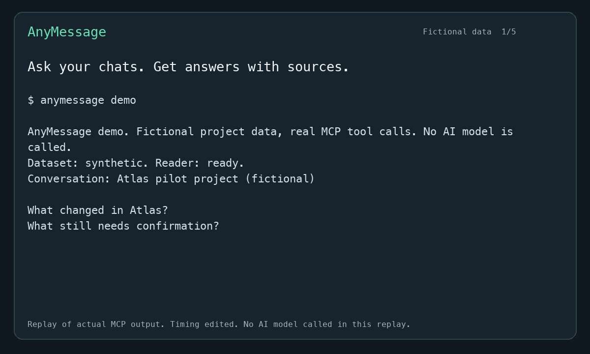

# AnyMessage

Ask your chats. Get answers with sources.

Give Codex, Claude, or Cursor read-only access to local WeChat conversations or a Telegram Desktop JSON export through MCP.
Ask what changed in a project, which decisions were approved, or what still needs confirmation.
Your AI does the analysis; AnyMessage returns messages, source IDs, coverage, and supported attachment content.

Start with [a key-free Telegram export](#try-a-telegram-export-without-keys), [a fictional WeChat project](#try-a-fictional-project), or [your own WeChat conversations](#install-and-set-up).
After trying it, [report whether it helped](docs/pilot.md).
[简体中文](README.zh-CN.md)



Replay of the original 0.4.0 Atlas investigation. Playback timing is edited; this replay does not call an AI model or show later context retrieval.
[Watch the 30-second video](.github/assets/demo.mp4) or [try the demo](#try-a-fictional-project).

AnyMessage provides a read-only stdio server for conversation listing, text history, exact-message context, conversation-scoped search, and local attachment reading.
The default WeChat reader reads local SQLCipher databases and committed WAL records without creating a separate plaintext message archive.
The Telegram reader reads one explicitly selected JSON file into an immutable text-only snapshot, without account keys or SQLCipher discovery.

This project is an early implementation.
The reader and optional key initialization have been exercised with WeChat 4.1.15 on Apple Silicon.
Other versions require validation against their local schemas.
There is no message sending, deletion, or cloud-history synchronization.

## Try a Telegram export without keys

AnyMessage 0.7.0 adds text search and exact-message context for Telegram Desktop JSON exports.
Download the [fictional River export](examples/telegram-fictional.json) and run it with the latest source:

```sh
curl --fail --location https://raw.githubusercontent.com/knchst/AnyMessage/main/examples/telegram-fictional.json --output telegram-fictional.json
uvx --from git+https://github.com/knchst/AnyMessage anymessage mcp --telegram-export "$PWD/telegram-fictional.json"
```

This starts a stdio MCP server. Connect an AI client using the [complete JSON or Codex TOML configuration](docs/telegram-export.md#connect-your-ai).
It needs neither WeChat nor SQLCipher, account keys, or saved WeChat settings.
Ask the client to search for `proposal` in the River project, then inspect that hit's neighboring records to find Maya's approval.
For your own data, export a chat as JSON in Telegram Desktop and select that file instead.

The file limit is 16 MiB. The reader fully loads the JSON in memory and retains no open file handle.
Restart the server to load changed bytes.
Export coverage can be incomplete. Rich-message bodies and Telegram media are unsupported; attachment tools report that explicitly.
See [export instructions, actual MCP calls, coverage, and limits](docs/telegram-export.md).

## Try a fictional project

The latest source includes a demo that reads fictional messages and an attachment through the real MCP tools.
It needs SQLCipher, but no WeChat installation, account keys, or AI subscription.
The WeChat demo requires AnyMessage 0.4.0 or later.
Install [uv](https://docs.astral.sh/uv/getting-started/installation/), then run:

```sh
brew install sqlcipher
uvx --from git+https://github.com/knchst/AnyMessage anymessage demo
```

The demo shows an approved battery change, an unconfirmed delivery date, and an unavailable drawing.
AnyMessage 0.5.0 adds a UTC date range and searches the project and supplier chats together in the demo.
AnyMessage 0.6.0 follows the proposal search hit to its adjacent approval and specification attachment with `get_message_context`.
It prints source evidence without calling an AI model.
Connect your own AI with `uvx --from git+https://github.com/knchst/AnyMessage anymessage demo --mcp`.
With AnyMessage 0.4.0 or later installed, run `anymessage demo` or `anymessage demo --mcp` directly.
See [the walkthrough and MCP configuration](docs/demo.md).

## Install and set up

```sh
brew install knchst/tap/anymessage
anymessage setup
```

Homebrew installs Python and SQLCipher with AnyMessage.
For a host supporting MCPB 0.4 and UV, see [MCPB requirements and distribution](docs/distribution.md).
Setup reuses existing valid keys and registers Codex by default.
It checks account selection and the core conversation and message databases before saving configuration references.
When several accounts exist, setup asks you to choose one.
Restart or reload Codex's MCP connection after registration, then call `status`.

For an existing manifest or another local client:

```sh
anymessage setup --keys-file "/absolute/path/private/manifest.json" --client cursor
anymessage mcp add claude-desktop
anymessage mcp add claude-code
anymessage mcp add grok
anymessage doctor
```

The built-in client names are `codex`, `cursor`, `claude-desktop`, `claude-code`, and `grok`.
Repeat `--client` during setup to register several clients, or use `--no-register`.
Registration preserves unrelated settings, TOML comments, and JSON comments.
An existing different AnyMessage entry requires `--replace` and gets a private backup before replacement.
An identical entry is left untouched.
`--replace` also permits setup to replace saved configuration references; it never overwrites key manifests.
Setup and registration refuse to replace symlink configuration files, including dangling links, even with `--replace`.
For a managed client configuration, run `anymessage mcp config --format toml` for Codex or Grok, or `anymessage mcp config --format json` for the JSON clients.
Add the generated entry to the managed target manually.
If AnyMessage's reference file is a symlink, edit its managed target manually or select a separate regular file with `ANYMESSAGE_CONFIG_FILE` before setup.

If no usable keys exist, read [the first-time setup guide](docs/wechat-setup.md).
Interactive setup asks for an existing manifest before offering temporary-copy capture.
Capture uses a temporary re-signed WeChat client and may require phone approval or login.
It requires native Apple Silicon macOS, Xcode command line tools with LLDB, and a normally quit original client.
Normal MCP use and `doctor` never invoke capture or change the WeChat application.

For scripts, pass `--non-interactive` and an existing `--keys-file`.
First-time capture additionally requires `--acknowledge-debug-copy`.
`doctor --json` reports readiness and prerequisites without message content.
`doctor` exits 0 when the reader is ready and 1 otherwise.
Setup and registration failures exit 2 with guidance on stderr.
Legacy `--status` prints the source status and retains its successful inspection exit code even when the source is not ready.

## Connect another MCP client

Any client that can launch a local stdio MCP server can use AnyMessage on the same Mac:

```sh
anymessage mcp config --format json
anymessage mcp config --format toml
anymessage mcp config --format json --server-only
anymessage mcp
```

Copy the generated entry into the client's configuration.
`--server-only` prints the server object for forms that provide their own wrapper.
Use `--client cursor` to include Cursor's explicit `type = stdio` equivalent in JSON.
`--command /absolute/path/bin/anymessage` selects another installation explicitly.
Registration retains the invoked executable's absolute symlink path, so a Homebrew upgrade does not pin a versioned Cellar path.
See [the JSON example](examples/mcp.json) and [the Codex example](examples/codex-mcp.toml).
No arguments also starts the stdio server for existing configurations.

For a same-Mac client that requires Streamable HTTP, start a separate server process:

```sh
anymessage mcp --transport streamable-http --port 8765
```

Connect that client to `http://127.0.0.1:8765/mcp` while the process runs.
The server binds only to `127.0.0.1`; setup does not start a background listener.
Loopback HTTP has no application authentication and is reachable by other local processes.
It is intended for clients on your Mac.

Grok Bot is separate from the local Grok CLI.
Grok Bot runs MCP tools on Grok Bot's computer, so a local command or loopback URL there cannot read this Mac's databases.
Its HTTP form needs a user-managed HTTPS proxy that authenticates requests and forwards to AnyMessage's loopback server.
AnyMessage does not create a tunnel, public listener, or authentication service.
Do not expose the unauthenticated loopback service directly to the internet.
Remote Grok Bot connectivity has not been verified.
`--client grokbot` reports this boundary instead of generating a misleading local entry.

## Install from a checkout

```sh
brew install sqlcipher
uv sync --locked
uv run anymessage setup --keys-file "/absolute/path/private/manifest.json"
```

Checkout development needs Python 3.11 or later and [uv](https://docs.astral.sh/uv/).
The repository does not assume a published PyPI package.

All seven tools advertise read-only behavior.
Call `status` first, then `list_conversations` to obtain a conversation id.
Date bounds and selected-conversation search require AnyMessage 0.5.0 or later.
Exact-message context requires AnyMessage 0.6.0 or later.

| Tool | Inputs | Result |
| --- | --- | --- |
| `status` | None | Selected source readiness and coverage. WeChat reports accounts, keys, and schema readiness; Telegram reports snapshot counts and limits. No message bodies are returned. |
| `list_conversations` | `limit` 1–200, `offset` 0–100000 | Newest-first local conversations, display names, summaries, and `next_offset`. |
| `get_messages` | `conversation_id`, `limit` 1–200, optional `cursor`, `start_time`, `end_time` | Newest-first messages from the selected source, with `next_cursor`. |
| `get_message_context` | `conversation_id`, `message_id`, optional `before` and `after` 0–50 each, default 3 | Exact anchor and nearest surrounding local records, oldest first, with `anchor_index` and `has_more_before` / `has_more_after`. |
| `search_messages` | Literal `query`, exactly one of `conversation_id` or `conversation_ids` with 1–8 distinct ids, `limit` 1–200, `scan_limit` 1–10000, optional `cursor`, `start_time`, `end_time` | Newest-first decoded text matches across the selection, shared scanned count, coverage, and continuation. |
| `list_attachments` | `conversation_id`, `message_id` | WeChat attachment descriptors and local availability. Telegram returns an explicit unsupported result. |
| `read_attachment` | `conversation_id`, `message_id`, `attachment_id`, optional `offset`, `limit`, `as_binary` | Verified WeChat attachment content. Telegram returns an unsupported error without opening media. |

The following attachment, identity, cursor, and database details describe WeChat.
Telegram uses the same input schemas with [source-specific identity, coverage, and cursor semantics](docs/telegram-export.md#source-contract).

`get_messages`, `get_message_context`, and WeChat search hits return row-derived `attachments` metadata without looking up files.
Call `list_attachments` with the message id to check availability, then pass its attachment id to `read_attachment`.
Extracted document pages are available as native MCP text and in the structured result's `text` field.
PDF, DOCX, XLSX, PPTX, UTF-8 text, and BOM-marked UTF-16 text have bounded text views.
Cached supported images return MCP image content; thumbnails are labeled separately from original and HD variants.
`as_binary=true` returns bounded original file bytes or decoded image bytes.
See [attachment formats, states, and limits](docs/attachments.md).

`start_time` and `end_time` are strict signed 64-bit UTC Unix-second integers, with an inclusive start and exclusive end.
Either bound can be omitted; when both are present, start must be less than end.
IDs contain 1–512 characters. Queries contain 1–1000 characters.
An empty selection never means all conversations; a selected chat without a local message table fails the call.
Results echo `conversation_ids`, `start_time`, and `end_time`.
See [date ranges and selected chats](docs/recipes.md#search-selected-chats-within-a-date-range) for examples and local-day conversion.

Reuse returned cursors without editing them, with the original selection, date bounds, and search query.
Selection order and page sizes can change.
Dated and multi-chat cursors bind the selected local account, chats, and bounds.
Unbounded single-chat calls retain legacy cursors, which cannot verify account identity.
Cursors mark a message position rather than a query; changing the query resumes at that position and leaves newer messages unsearched for the new query.
Cite and deduplicate messages by the pair `(conversation_id, id)`.
The `id` contains the shard and local id and can repeat in another chat.
To inspect a hit, pass its `conversation_id` and `id` as `message_id` to `get_message_context`.
Context includes the anchor exactly once, at zero-based `anchor_index`, and returns at most 101 records in chronological order.
`before` and `after` count records, including unsupported or decode-failed messages.
Even when a count is zero, its `has_more_*` flag reports whether local records exist on that side.
The result echoes scalar `conversation_id` and `message_id`; it has no `next_cursor`.
An absent or ambiguous anchor in an existing chat returns `message_not_found`; no local table for the chat returns `conversation_not_found`.
Message IDs retain the discovered shard spelling and use a canonical positive ASCII decimal local id no greater than `9223372036854775807`.
See [inspect a search hit](docs/recipes.md#inspect-a-search-hit) for a complete call.
Search is case-insensitive literal matching after decoding; SQL wildcard characters remain literal.
`scanned` counts inspected records across all selected chats, including unsupported records and decoding failures, for the current call.
Raw lookahead rows do not count and are not decoded. Search does not inspect attachment bodies.
`truncated=true` means more records remain beyond the current result or scan limit.
`incomplete=true` also covers text decoding failures.
Unsupported non-text records are counted separately.
History, context, and search report checked shards and `snapshot_consistency="per_query"`; each SQL query can reflect a separate committed state.
Local decoded text coverage does not establish complete cloud history.

## WeChat configuration

Setup stores path and account references in `~/Library/Application Support/AnyMessage/config.json`, with mode 0600.
Key bytes stay in their private manifest.
Settings resolve in this order: explicit setup options, environment variables, saved references, then defaults.
SQLCipher commands and paths must resolve to executable files.
An invalid explicit option, environment variable, or saved SQLCipher reference reports missing SQLCipher without falling back to another installation.
Correct that selection before retrying setup or capture.
`ANYMESSAGE_CONFIG_FILE` selects another reference file; generated client entries carry that override when set.
Setup also recognizes an existing `wechat/keys.json` next to the reference file when no key path is configured.
Changing environment variables in a terminal does not change an already running MCP client.
Run setup to save references or set the client's own environment explicitly.

| Variable | Purpose |
| --- | --- |
| `ANYMESSAGE_CONFIG_FILE` | Optional path to the saved reference file. |
| `ANYMESSAGE_KEYS_FILE` | Private JSON manifest containing the selected account's per-database raw keys. |
| `ANYMESSAGE_ACCOUNT` | Opaque account id returned by `status`, required when several accounts are discovered. |
| `ANYMESSAGE_DATA_DIR` | Optional `xwechat_files` directory, account directory containing `db_storage`, or `db_storage` itself. |
| `ANYMESSAGE_SQLCIPHER` | Optional SQLCipher executable command or path; otherwise use `PATH` or standard Homebrew locations. |

By default, account discovery uses `~/Library/Containers/com.tencent.xinWeChat/Data/Documents/xwechat_files`.
Keys are supplied through a local file, not MCP arguments or command-line key values.
The manifest accepts this shape, with paths relative to `db_storage`:

```json
{
  "keys": {
    "session/session.db": {"enc_key": "<64 hexadecimal characters>", "salt": "<32 hexadecimal characters>"},
    "contact/contact.db": {"enc_key": "<64 hexadecimal characters>"},
    "message/message_0.db": {"enc_key": "<64 hexadecimal characters>"},
    "hardlink/hardlink.db": {"enc_key": "<64 hexadecimal characters>"},
    "message/message_resource.db": {"enc_key": "<64 hexadecimal characters>"}
  }
}
```

Each encrypted message shard needs its matching key entry.
File attachments also need access to `hardlink/hardlink.db`.
Images without a cache identity in the message row need `message/message_resource.db`.
These attachment databases are checked on demand; a ready `status` does not establish attachment availability.
The optional `salt` must match that database's first 16 bytes.
An unwrapped database mapping is also accepted.
Use an owner-only directory and run `chmod 600` on the manifest.
Never commit the manifest or real database files.

## WeChat limits

Only `message/message_N.db` message shards are supported.
Business-account shards, video and voice decoding, nested forwarded attachments, sending, and global history indexing are not implemented.
Attachment metadata supports direct file app messages, including compressed and group-prefixed XML.
Text history and search retain their existing text-only behavior; search does not scan attachment contents.
Attachment reads use existing local caches and never download missing content.
WeChat's retention and synchronization state determine which records exist locally.
Queries spanning databases do not form one atomic snapshot.
A missing key or unreadable supported shard fails history, context, and search retrieval instead of silently returning partial results.

The reader opens SQLCipher with `-readonly` and `query_only=ON`.
SQLite can still use ordinary shared-memory and read-lock coordination for an active WAL database.
The optional bootstrap's effects are separate from the read-only server and are described in its setup guide.

## Develop and verify

```sh
uv sync --locked --group dev
uv run pytest -q
python3 scripts/check_publication.py
uv build
python3 scripts/check_publication.py --archive dist/*.whl dist/*.tar.gz
```

The default suite uses only synthetic data, including Telegram parsing, snapshot cursors and context, CLI onboarding, configuration preservation, stdio and loopback HTTP round trips, real SQLCipher-encrypted fixtures, compressed text, multiple shards, pagination ties, literal search, committed WAL reads, rejected writes, attachment integrity and path checks, document extraction, V2 image decoding, and native text, image, and binary results over both MCP transports.
See [CONTRIBUTING.md](CONTRIBUTING.md), [the architecture](docs/architecture.md), and [the database research notes](docs/wechat-research.md).

## License

AnyMessage is [MIT licensed](LICENSE).
The optional vendored bootstrap tools retain their original MIT notice; see [THIRD_PARTY_NOTICES.md](THIRD_PARTY_NOTICES.md).
WeChat and SQLCipher are installed separately and are not distributed by this repository.
