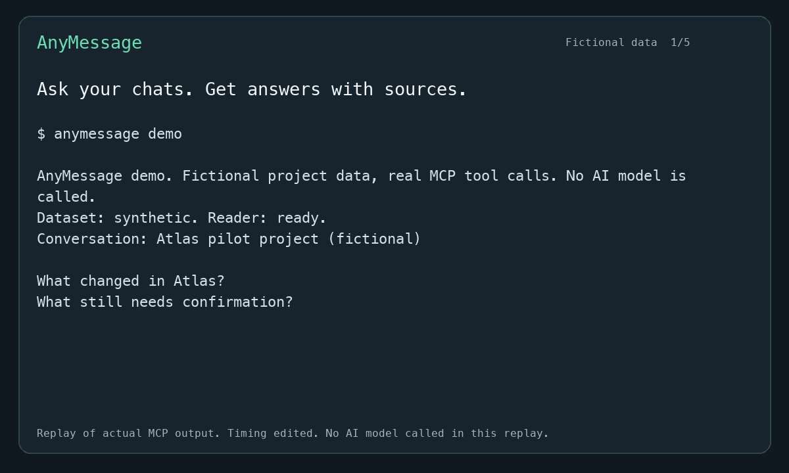

# AnyMessage

用你熟悉的 AI，查清聊天里的决定。

通过 MCP，让 Codex、Claude 或 Cursor 只读访问 Mac 本地的微信聊天记录和已缓存的附件。
你可以问项目的规格改了什么、哪些方案已经确认、还有什么需要跟进。
AI 负责分析，AnyMessage 返回消息、来源 ID、查询范围和支持的附件内容。

[English](README.md) | [虚构项目演示](docs/demo.md) | [使用示例](docs/recipes.md)



这是实际 MCP 输出的编辑回放，播放时间经过调整，回放过程不调用 AI。
[观看 30 秒视频](.github/assets/demo.mp4)。

## 先试一个虚构项目

演示使用临时生成的虚构聊天和附件，通过真实的 MCP 工具读取。
需要 SQLCipher，不需要安装微信、获取账号密钥或订阅 AI 服务。
演示命令目前在最新源码中，当前 Homebrew 发布版尚未包含。

安装 [uv](https://docs.astral.sh/uv/getting-started/installation/) 后运行：

```sh
brew install sqlcipher
uvx --from git+https://github.com/knchst/AnyMessage anymessage demo
```

终端演示只展示工具返回的证据，不调用 AI，也不自动生成分析结论。
虚构的 Atlas 项目里有已批准的电池变更、尚未确认的交期和无法读取的图纸。

| 事项 | 人工核对的结论 | 消息来源 |
| --- | --- | --- |
| 电池 | Maya 已批准从 400 mAh 改为 500 mAh。 | `message/message_0.db:3`，2026-11-09 09:03 UTC。 |
| 数量 | 试产数量仍为 50。 | 同一条批准消息和消息 `:4` 的规格附件。 |
| 交期 | 11 月 26 日只是提议，工厂尚未确认。 | Chen 的消息 `:7`，09:07 UTC，以及规格附件。 |
| 厚度 | 还需要图纸才能确认；消息 `:6` 的图纸缓存不存在。 | 消息 `:5`、`:6`、`:8`。 |

这张表是对虚构数据的人工核对示例，不是命令自动生成的答案。
所有简写 ID 的前缀都是 `message/message_0.db:`，会话 ID 为 `atlas-demo@chatroom`。

要让 AI 分析同一份虚构数据，请在本地 MCP 客户端中创建独立的 `anymessage-demo` 连接，使用以下命令作为服务器：

```sh
uvx --from git+https://github.com/knchst/AnyMessage anymessage demo --mcp
```

[演示文档](docs/demo.md#connect-your-ai)提供 JSON 和 Codex TOML 配置。
重新连接后，可以这样问：

> 只使用 anymessage-demo 工具，先检查 status。阅读 Atlas 试产项目的聊天和可读取的附件，分别列出已批准的变更、待批准的提议和未解决的问题。每个结论都写明发送者、UTC 时间和消息 ID。列出无法读取的附件，并核对 11 月 26 日交期是否已经批准。

## 连接自己的微信

```sh
brew install knchst/tap/anymessage
anymessage setup
```

安装会包含 Python 和 SQLCipher。
设置会优先复用已有的有效密钥，默认注册 Codex；完成后需要重启或重新加载 MCP 连接。
没有密钥时，需要阅读[首次设置说明](docs/wechat-setup.md)，通过明确授权的临时微信副本获取。
该步骤可能需要手机确认或登录。
普通读取和 `doctor` 不会启动密钥获取，也不会修改微信应用。

```sh
anymessage mcp add claude-desktop
anymessage mcp add claude-code
anymessage mcp add cursor
anymessage doctor
```

完整的配置、环境变量、其他本地客户端和 HTTP 连接方式见[英文参考](README.md)。

## 当前支持范围

- 当前数据源为微信 4.x；已验证的环境是 Apple Silicon 和微信 4.1.15，其他版本需要验证。
- 支持会话列表、分页消息、单个会话内的有界文本搜索，以及支持格式的本地附件读取。
- 文档包括 PDF、DOCX、XLSX、PPTX 和 Unicode 文本；支持部分原始图片及 V2 图片缓存。
- 未实现发送、删除、云端聊天同步、全会话搜索、语义搜索、OCR、语音和视频解码。
- 本地不存在的附件不会自动下载；缩略图和原图分别标识。

先调用 `status`，再用 `list_conversations` 获取会话 ID。
搜索结果如果有 `incomplete` 或继续游标，只代表已扫描的范围。
未找到缓存不能单独证明附件已删除或已过期。

读取在本机进行，但 AI 客户端可能把返回的内容发送给模型服务商。
普通 MCP 连接默认使用 stdio；显式启动的 HTTP 服务仅监听 `127.0.0.1`，不提供应用级认证。
详见[安全说明](SECURITY.md)和[附件格式与限制](docs/attachments.md)。

## 参与开发

欢迎补充兼容性验证、使用示例和导入步骤的反馈。
请使用虚构数据复现问题，不要上传真实消息、账号、密钥或数据库。
开发和验证步骤见[贡献指南](CONTRIBUTING.md)。

AnyMessage 使用 [MIT 许可证](LICENSE)。
